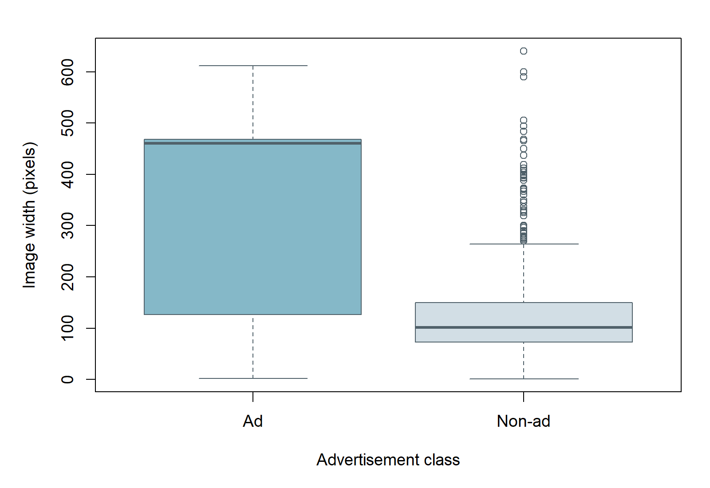
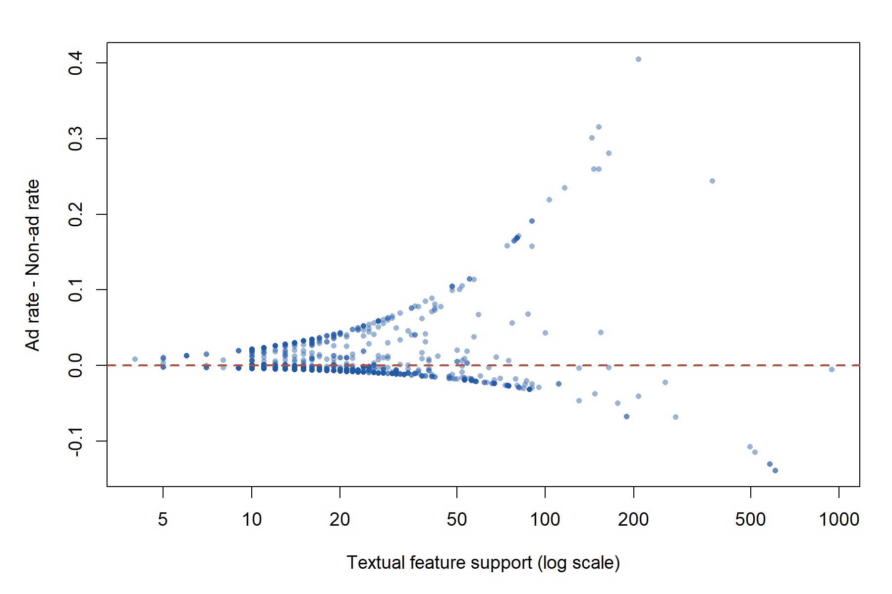

# Multiple-Testing Analysis of Textual Indicators in the Internet Advertisements Dataset


Major Assignment Repository for **MT2013 – Probability and Statistics** (Class **CC04**, Project Group **5**, Semester 1 – Academic Year 2026–2027) at **Ho Chi Minh City University of Technology (HCMUT)**.

- **Instructor:** Dr. Nguyễn Tiến Dũng (Faculty of Applied Sciences)
- **Student Faculty:** Faculty of Computer Science and Engineering
- **Assigned Dataset:** Internet Advertisements (Dataset #5)

---

## Overview

Web-page images carry both geometric dimensions and textual/HTML metadata (URLs, anchor links, `alt` attributes, and captions). Testing 1,554 textual indicators individually without adjustment can lead to accumulated false rejections. Overlapping textual patterns can induce dependence among tests, while sparse contingency tables can make large-sample approximations unreliable.

This project investigates marginal associations between **1,554 binary textual indicators** and advertisement status (`ad.` vs. `nonad.`) across **3,279 image records** (459 Ad and 2,820 Non-ad).

The analytical workflow includes:

1. **Data validation and preprocessing**, retaining all records for the primary textual analysis.
2. **Descriptive statistics** for image geometry, textual feature support, and occurrence-rate differences.
3. **Two-sided Fisher's exact tests** for feature-level inference.
4. **Benjamini–Yekutieli (BY)** FDR control at q = 0.05 as the primary procedure, compared with Benjamini–Hochberg (BH) and Bonferroni adjustment.
5. **Sensitivity analysis** giving each distinct recorded profile equal weight.
6. **Feature redundancy analysis** identifying indicators with identical occurrence vectors.

BY controls FDR under arbitrary dependence among tests, provided the individual null p-values are valid. It does not correct violations of observation-level independence.

---

## Key Results

### Multiple-Testing Comparison

| Procedure                                | Error Criterion | Nominal Level | Discoveries | Share of Family |
| :--------------------------------------- | :-------------: | :-----------: | ----------: | --------------: |
| **Benjamini–Yekutieli (BY)** _(Primary)_ |       FDR       |     0.05      |     **447** |      **28.76%** |
| Benjamini–Hochberg (BH)                  |       FDR       |     0.05      |         489 |          31.47% |
| Bonferroni                               |      FWER       |     0.05      |         379 |          24.39% |

- In this dataset, the discovery sets are strictly nested: Bonferroni ⊂ BY ⊂ BH.
- Among the 447 BY discoveries, 365 occur more frequently in advertisements and 82 in non-advertisements.
- The largest observed occurrence-rate difference is for `X1243` (`ancurl*com`): 41.18% in Ad images versus 0.64% in Non-ad images, a difference of **40.54 percentage points**.

### Sensitivity to Repeated Profiles

| Metric                                           | All Records | Distinct Profiles |
| :----------------------------------------------- | ----------: | ----------------: |
| Observations                                     |       3,279 |             2,423 |
| Textual indicators tested                        |       1,554 |             1,554 |
| BY discoveries                                   |         447 |               389 |
| `ancurl*com` rate difference (percentage points) |      +40.54 |            +42.68 |

Of the 447 primary BY discoveries:

- 386 (86.4%) remained selected.
- 61 were no longer selected.
- 3 additional indicators entered the discovery set.
- All 10 primary discoveries with the largest absolute rate differences remained selected.

### Feature Redundancy

| Indicator Set  | Indicators | Distinct Vectors | Additional Identical Vectors |
| :------------- | ---------: | ---------------: | ---------------------------: |
| All indicators |      1,554 |              760 |                          794 |
| BY discoveries |        447 |              256 |                          191 |

Multiple indicators can represent identical observed evidence. These counts describe exact feature redundancy, not the number of independent signals or false discoveries.

The findings describe marginal associations rather than causal effects or out-of-sample predictive performance. Equal profile weighting does not establish observation-level independence.

### Visual Highlights

<table>
  <tr>
    <td align="center" width="50%">
      <br />
      <sub><b>Figure 4.1.</b> Distribution of observed image widths by class.</sub>
    </td>
    <td align="center" width="50%">
      <br />
      <sub><b>Figure 4.3.</b> Occurrence-rate differences versus textual feature support.</sub>
    </td>
  </tr>
</table>

---

## Repository Structure

```text
MT2013-Internet-Advertisements/
├── add.csv
├── ad.names
├── MT2013_analysis.R
├── MT2013_cleaned.csv
├── figures/
│   ├── Figure1_support_feature.png
│   ├── Figure2_occurence_rates.png
│   └── Figure3_width_boxplot.png
├── outputs/
│   └── T07_inference_results.csv
├── report/
└── README.md
```

- `add.csv`: Original analysis input (3,279 rows × 1,560 columns).
- `ad.names`: Original UCI attribute schema and textual indicator names.
- `MT2013_analysis.R`: Complete Base R analysis pipeline.
- `MT2013_cleaned.csv`: Validated dataset (3,279 rows × 1,559 columns).
- `figures/`: Generated descriptive figures.
- `outputs/`: Full primary inference results.
- `report/`: Final project report.

---

## Reproducibility

The analysis was performed using **R 4.6.1** and functions from its standard distribution. No additional R packages are required.

### Run the Analysis

```bash
git clone https://github.com/baonguyenkim0309/MT2013-Internet-Advertisements.git
cd MT2013-Internet-Advertisements

Rscript MT2013_analysis.R
```

Alternatively, open `MT2013_analysis.R` in RStudio, set the working directory to the repository root containing `add.csv`, and run the entire script.

### Generated Outputs

| Output                              | Description                                                                               |
| :---------------------------------- | :---------------------------------------------------------------------------------------- |
| `MT2013_cleaned.csv`                | Validated and standardized dataset                                                        |
| `figures/`                          | Three descriptive PNG figures                                                             |
| `outputs/T07_inference_results.csv` | Results of all 1,554 primary Fisher tests, adjusted p-values, and discovery indicators    |
| Console                             | Numerical results for Sections 3–6, including sensitivity analysis and feature redundancy |

Missing geometric and structural values are retained as `NA`. Repeated profiles are retained in the primary analysis and examined separately in the sensitivity analysis.

---

## Contributors (Class CC04 – Group 5)

| Member                    | Student ID | Main Responsibilities                                                                   |
| :------------------------ | :--------: | :-------------------------------------------------------------------------------------- |
| **Nguyễn Anh Minh Tuệ**   | `2353281`  | Data auditing support; discussion, limitations, and extensions (Section 6)              |
| **Lê Quốc Bảo**           | `2550264`  | Dataset review; descriptive statistics and visualizations (Sections 1 & 4)              |
| **Nguyễn Kim Bảo**        | `2550265`  | Research design; statistical theory, inference, and report integration (Sections 2 & 5) |
| **Nguyễn Lâm Vĩnh Khang** | `2550297`  | Schema validation; data preprocessing; data and code documentation (Sections 3 & 7)     |

<sub>The submitted report also documents withdrawn members and their 0% project contribution.</sub>

---

## Data Source & References

- **UCI Machine Learning Repository:** N. Kushmerick (1999), _Internet Advertisements_, DOI: [10.24432/C5V011](https://doi.org/10.24432/C5V011).
- **Course-provided Kaggle mirror:** [UCI ML – Internet Advertisements Data Set](https://www.kaggle.com/datasets/uciml/internet-advertisements-data-set/data).

### Key Methodological References

- Agresti, A. (2013). _Categorical Data Analysis_ (3rd ed.). John Wiley & Sons.
- Benjamini, Y., & Hochberg, Y. (1995). Controlling the false discovery rate: A practical and powerful approach to multiple testing. _JRSS-B_, 57(1), 289–300.
- Benjamini, Y., & Yekutieli, D. (2001). The control of the false discovery rate in multiple testing under dependency. _The Annals of Statistics_, 29(4), 1165–1188.
- Dunn, O. J. (1961). Multiple comparisons among means. _Journal of the American Statistical Association_, 56(293), 52–64.
- Fisher, R. A. (1935). _The Design of Experiments_. Oliver and Boyd.
- Kushmerick, N. (1999). Learning to remove internet advertisements. _AGENTS '99_, 175–181.
- R Core Team (2026). _R: A Language and Environment for Statistical Computing_. R Foundation for Statistical Computing.
